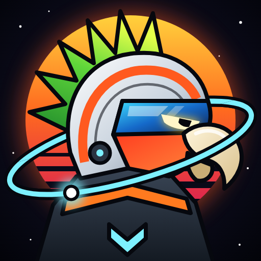

<p align="center"></p>

# Birdtier — Beyond the Solar System

**Play it:** https://abbas-is-tuff.github.io/Birdtier/ (desktop with keyboard and mouse, or a phone/tablet with touch controls)

A browser-based space exploration simulator flown by a crew of bird astronauts set in the **Kaelis system**, an original fictional star system.
You design rockets, fly them under real Newtonian physics, land on other worlds, walk and drive on their surfaces,
collect science and build colonies that have to keep their crews alive.

Runs in any modern browser with WebGL2 (Chrome, Edge, Firefox, Safari 17+), on desktop or on phones and tablets.

---

## Running it

### Option A — just play (no install)

Open the link above, or download `docs/index.html` and open it in a desktop browser. Everything, including all code, is inside that one file.

### Option B — run the project locally

Needs [Node.js](https://nodejs.org) 20 or newer.

```bash
cd Birdtier
npm install          # one-time: installs three, react, vite
npm run dev          # starts the dev server
```

Then open **http://localhost:5173/app.html** in your browser (it opens automatically). The `index.html` at the top of the repo only forwards visitors to the built game in `docs/`.

Other scripts:

| Command | What it does |
|---|---|
| `npm run build` | Production build into `dist/` (serve it with any static file server, or `npm run preview`) |
| `npm run build:single` | Builds one self-contained `dist-single/index.html` |
| `npm run build:pages` | Rebuilds the one-file game into `docs/` for GitHub Pages (commit and push afterwards) |
| `npm test` | Headless physics checks plus autopilot flights (pad to orbit, landings on Miro, Thalen, Ordun and Pell) |
| `python3 tests/fun.py` | Browser play-through: Quick Start, fast travel, assisted landing, bird rescue, upgrade shop |
| `python3 tests/tour.py ascent orbit miro colony screens` | Optional end-to-end browser tour (needs Python Playwright + Chrome, dev server running) |
| `python3 tests/systems.py` | Forces each random event and drives the rover, reporting console errors |
| `python3 tests/mobile.py` | Phone emulation (touch, landscape and portrait): throttle, staging, joystick, EVA, sheets, workshop |
| `python3 tests/crew.py` | Picks pilots, checks every perk changes the numbers, and screenshots each bird on EVA |

Saves go to the browser's `localStorage`, so progress persists between sessions on the same browser.

---

## First flight (quick start)

1. Pick your astronaut on the main menu, then **New Mission** → the starter rocket *Wayfarer I* is on the pad at Halden Reach.
2. Press **Z** (full throttle), then **Space** to ignite.
3. At ~1 km, hold **D** briefly to tip a few degrees east; let the nose follow the prograde marker (SAS **2**).
4. When **Apoapsis** reaches ~80 km, cut throttle (**X**), time-warp (**.**) to near apoapsis, and burn prograde until **Periapsis** rises above 70 km.
5. Open the map (**M**) to see your orbit, select Miro, and plan the transfer.

---

## Playing on a phone or tablet

Touch controls switch on automatically on touch screens (Settings → Touch controls: Auto / On / Off), and phones
start on Low graphics. Hold the phone sideways for the best view; portrait works too.

| Control | What it does |
|---|---|
| Joystick (bottom left) | Steer the rocket (up/down = pitch, left/right = yaw); walk on EVA; drive the rover |
| Roll ⟲ / ⟳ | Roll the rocket |
| Turn / Slide | With RCS on, switches the joystick to sliding the craft (for docking) |
| Throttle slider, Max, Cut | Engine throttle |
| Stage / Jump | Fire the next stage; jump on EVA |
| Drag the screen / pinch | Look around / zoom |
| Action row (bottom) | SAS modes, RCS, gear, solar, science, EVA, colony, map, camera (scrolls sideways) |
| Info (top bar) | Full flight, orbit, environment, vessel and mission data |

Full screen is in the main menu and the pause menu (Android browsers; on iPhone, use Share → Add to Home Screen).

## Controls (all rebindable in Settings)

| Key | Action | Key | Action |
|---|---|---|---|
| W / S | Pitch (walk/drive on surface) | Space | Stage / jump |
| A / D | Yaw (turn on surface) | T | SAS on/off |
| Q / E | Roll | 1 2 3 4 | SAS: stability / prograde / retrograde / radial out |
| ↑ / ↓ | Throttle | R | RCS on/off |
| Z / X | Full / cut throttle | H N J L I K | RCS translate |
| G | Landing gear | U | Solar arrays |
| . / , | Time warp up / down | P or Esc | Pause |
| M | System map | C | Next camera |
| F | EVA / board / dock / rover | V | Collect sample (EVA) |
| O | Deploy science station (EVA) | Y | Run instruments |
| B | Colony panel | Mouse drag / wheel | Orbit / zoom camera |

---

## Quick and easy play

- **Quick Start** (main menu): a fresh rocket already in orbit around Thalen.
- **Autopilot**: *Auto → Orbit* flies a gravity turn to a stable orbit; *Auto → Land* brakes and lands on
  the world below (on Thalen's thick air it can drop to the capsule and use the parachute). It flies the real
  physics with real fuel; touching any flight control hands control back to you.
- **Fast travel**: open the map (M), pick a planet or moon, and press *Travel*. It shows the Δv the trip needs
  and what you have, spends that fuel, skips the coast and arrives in a parking orbit.
- **Land here**: from orbit, each place to find on a world has a *Land here* button for an assisted descent next to it.

## Things to find

Every solid world hides glowing beacons you can see from orbit:

- **Seed caches** (gold): Space Seeds to spend in **Upgrades** (engines, tanks, batteries, landing legs,
  a bird jetpack, turbo rover, seed magnet).
- **Alien ruins** (purple): Space Seeds and science.
- **Stranded birds** (green): rescue them on EVA and they join your crew.

Two are a short walk from the launch pad. A pointer on screen shows the nearest one and how far it is.

## The crew

You start with Abbas, Cookie and Lightning; eleven more birds are stranded on other worlds and join when
rescued. Every bird talks on the radio (with its own personality and chirp) when things happen. Pick your
pilot on the main menu or in the workshop. The pilot appears on EVA as a bird in a glass helmet and
life-support pack (in their own colours), shows in the flight HUD, and brings one perk that changes the game's numbers.

| Bird | Species | Role | Perk |
|---|---|---|---|
| Abbas | Peach-faced lovebird | Commander | +15% science from all experiments |
| Salman | African grey | Engineer | Repairs take half the time |
| Cookie | Cockatiel | Scout | Walks 45% faster on EVA, but samples are worth 15% less (fast but lazy) |
| Lightning | Grey cockatiel | Rover driver | Rover drives 35% faster |
| Pikachu | Lutino cockatiel | Scientist | Samples and science stations worth 30% more |
| Silver | Lovebird | Explorer | Triple science for discovering new locations |
| Aziz | Indian ringneck | Pilot | Jumps 60% higher on EVA |
| Lemon | Rainbow lorikeet | Quartermaster | Launches cost 15% less |
| Mango | Peach-faced lovebird | Navigator | +10% science, double discovery science |
| Coco | Rainbow lorikeet | Adventurer | Walks and drives 20% faster |
| Mercury | Young cockatiel | Cadet | Jumps 30% higher, walks 15% faster |
| Orange | Canary | Radio operator | Mission rewards pay 20% more funds |
| Jafar | Zebra finch | Cook | 30% more Space Seeds from caches |
| Snowflake | White cockatiel | Systems engineer | +40% battery, 30% faster repairs |

The crew lives in `src/crew/crew.js`: add a bird by adding an entry with its colours and perk.

## What is in the game

**World.** One star (Kaelis), 5 planets — volcanic Cindra, ocean home world Thalen, desert Ordun, ringed gas giant
Brannoch, icy Ysolde — 8 moons, 2 asteroid belts and 2 orbital stations. Each body has its own mass, radius,
gravity, rotation, orbital period, atmosphere composition, temperature model, procedurally generated terrain and
day/night cycle. The Planetary Database screen shows all of these numbers.

**Physics.** Planets and moons follow exact Keplerian orbits (Kepler's equation solved numerically each frame).
The spacecraft is integrated numerically with velocity Verlet under the gravity of *every* body, plus thrust,
fuel-mass loss and atmospheric drag (implicit, unconditionally stable). The step size adapts to altitude and
acceleration; if a warp level would make integration unstable the game lowers it. Atmospheres rotate with their
planet. Time warp: 1×, 2×, 5×, 10×, 100× while thrusting or in atmosphere; 1 000× to 100 000× when coasting
in space or landed. Pause at any time.

**Spacecraft.** 20 parts with real effects: tanks hold propellant, engines burn it at their Isp (sea-level and
vacuum), solid boosters can't be throttled, solar panels generate power that depends on distance from the star
and on eclipses, batteries store it, reaction wheels and RCS consume charge/monopropellant, legs raise crash
tolerance, parachutes add drag, docking ports allow refuelling at stations, cargo containers carry construction
materials, and a rover bay carries a drivable rover. Mass, thrust, TWR and Δv per stage are computed live.

**Surface.** Land, go on EVA, walk (low gravity changes your jumps), collect samples, deploy science stations,
discover named biomes, drive the rover. Terrain near you is rebuilt from the same height function used for
collision, so what you see is what you land on.

**Colonies.** Found one with a habitat and cargo materials, then add solar farms, greenhouses, storage,
laboratories, landing pads and antennas. Oxygen, water, food, power, temperature and materials are simulated;
colonies can fail if they run out. Remote orders travel at light speed and need an antenna.

**Events.** Solar storms (comms blackout, SAS dropout, more failures), equipment failures (repairable), weather
(dust storms, ashfall, blizzards that cut solar output), meteor showers on thin-atmosphere worlds, rogue asteroid
near-misses (collisions destroy the craft), eclipses, and light-speed communication delay for science and orders.

**Progression.** Start with a basic rocket, 25 000 funds, one mission and tier-0 parts. Earn funds, science and
materials through 12 chained missions, experiments, samples and discoveries; spend science on 3 research tiers.
No real-money anything.

**Graphics.** Physically based materials, a single-scattering atmosphere shader, cloud layers, ring system,
star corona glow, procedural starfield, engine and dust particles, water with animated normals, shadow
maps near the vehicle, a logarithmic depth buffer for planet-to-spacecraft scale, and a floating origin to avoid
precision jitter. Five cameras: chase, cockpit, orbital, surface and free. Low / Medium / High quality presets.

---

## Project layout

```
src/
  physics/     constants, Kepler solver, orbital elements
  world/       system data, star-system state, noise, procedural terrain & biomes
  spacecraft/  part catalogue, designs & Δv maths, the Craft simulation (integrator, staging, systems)
  crew/        the bird astronaut roster (colours, roles, perks) and radio chatter
  explore/     seed caches, ruins and stranded birds; upgrades
  surface/     astronaut and rover movement on a body's surface
  colony/      colony life-support and construction
  events/      dynamic event system
  missions/    mission chain and checks
  render/      renderer, planets, atmosphere, terrain LOD, sky, models, particles, cameras, map
  game/        Game orchestrator, input with rebinding, settings and saves
  ui/          React screens: menu, HUD, workshop, database, settings, colony panel
tests/         physics unit checks and browser tours
```

---

## Known limitations (honest list)

- **Scale.** The system is roughly 1/10 real scale so a mission fits in a play session. The physics is real at that scale.
- **Spacecraft are a single rigid body** stacked in stages; there is no free-form part placement and no
  part-by-part structural failure. The workshop builds vertical stacks with radial attachments.
- **Collisions** use a custom solver (ground contact from the terrain height function, sphere tests against
  passing asteroids) rather than a general physics engine; general-purpose engines don't handle
  planetary distances in double precision. Landed craft are anchored to the surface rather than tipping over.
- **Gas giants and the star** cannot be landed on; descending into Brannoch is fatal by design.
- **WebGPU is not used.** The renderer is WebGL2 only; the Settings screen reports whether your browser supports WebGPU.
- **Terrain texture generation** runs on the main thread in small time slices, so high-resolution planet
  textures fade in over a few seconds after you approach a body.
- **Docking** is a proximity/speed check (within 150 m, under 3 m/s) rather than port-to-port alignment.
- Sound is limited to the birds' radio chirps.
- **Fast travel** and **Land here** are shortcuts: fast travel uses a patched-conic Δv estimate and skips the coast instead of flying the transfer, and *Land here* starts the descent a few kilometres above the site.
- The autopilot is tuned for the stock rockets; very unusual designs (very low thrust, no engine on the last stage) may not reach orbit or land.
- Touch controls have been tested in phone emulation, not on every real device; very old phones may run slowly even on Low.

See `LICENSES.md` for third-party libraries.
